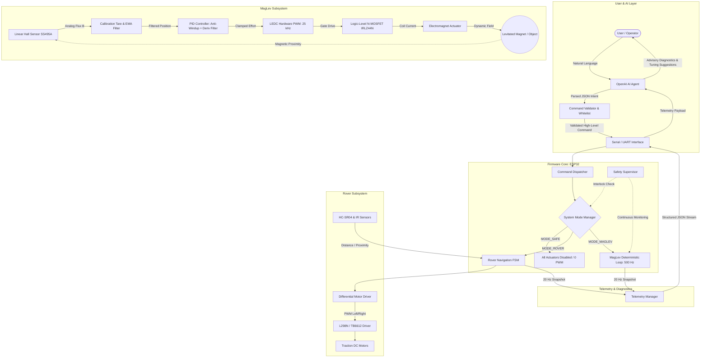
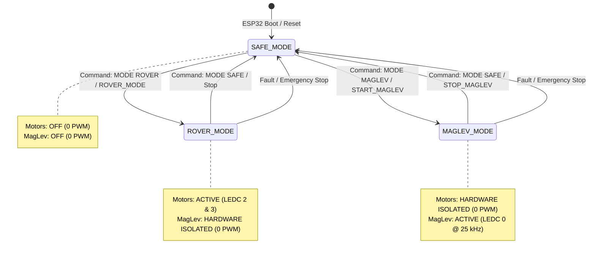

# RoboSense – AI-Integrated Smart Rover & Electromagnetic Levitation (MagLev) Platform

[](https://opensource.org/licenses/MIT)
[](https://www.espressif.com/en/products/socs/esp32)
[](https://www.arduino.cc/)
[](https://www.python.org/)
[](https://openai.com/)
[]()

> **Engineering Notice**: This project implements **active electromagnetic levitation (MagLev)**. In physics, Earnshaw's Theorem proves that stable levitation cannot be achieved using static magnetic fields alone. The technical objective is closed-loop feedback control using an electromagnet, magnetic flux/position sensing, and high-frequency discrete PID control. This is not "anti-gravity"—it is a real-time electromagnetic balance of gravitational and magnetic forces.

---

## Table of Contents
1. [Overview](#overview)
2. [Key Features](#key-features)
3. [System Architecture](#system-architecture)
4. [Hardware Components & Engineering Rationale](#hardware-components--engineering-rationale)
5. [Electrical Wiring & Safety Schematic](#electrical-wiring--safety-schematic)
6. [Firmware Architecture & Control Loop](#firmware-architecture--control-loop)
7. [Control Theory: Magnetic Levitation & PID](#control-theory-magnetic-levitation--pid)
8. [Sensor Calibration & Tare Procedure](#sensor-calibration--tare-procedure)
9. [Experimental PID Tuning Guide](#experimental-pid-tuning-guide)
10. [Electrical & Mechanical Safety Systems](#electrical--mechanical-safety-systems)
11. [AI Integration & Security Command Layer](#ai-integration--security-command-layer)
12. [Operating Modes & Hardware Interlocks](#operating-modes--hardware-interlocks)
13. [Telemetry Specification](#telemetry-specification)
14. [Engineering Limitations & Test Status](#engineering-limitations--test-status)
15. [Quickstart & Verification](#quickstart--verification)

---

## Overview

**RoboSense** is a dual-subsystem embedded robotics platform engineered around the **ESP32 microcontroller**:

1. **Autonomous Rover System**: A differential-drive mobile robotics platform featuring dual H-bridge motor driving, HC-SR04 ultrasonic rangefinding, dual infrared proximity sensing, and autonomous obstacle avoidance state machines.
2. **Experimental MagLev Control Module**: An active electromagnetic levitation subsystem demonstrating closed-loop position stabilization of a ferromagnetic payload. Operates at a deterministic 500 Hz control loop with discrete PID control, exponential sensor filtering, and hardware safety supervision.
3. **AI Diagnostic & Command Gateway**: An OpenAI-powered natural language translation and control-systems diagnostic layer that validates commands against an embedded whitelist and provides real-time telemetry diagnostics without ever granting the LLM direct access to low-level hardware registers or PWM duty cycles.

---

## Key Features

### 1. Autonomous Rover System
- **Dual H-Bridge Differential Drive**: Direct control of L298N / TB6612FNG drivers via ESP32 hardware LEDC PWM (5 kHz).
- **Obstacle Avoidance FSM**: Finite state machine with real-time median-filtered distance acquisition, backing-up routines, and obstacle detour logic.
- **Strict Subsystem Isolation**: Motor drive logic is modularized in `firmware/src/rover/` and cannot execute while the MagLev coil is active.

### 2. MagLev Control Module
- **Deterministic 500 Hz Control Interval**: Microsecond delta-scheduled execution (`2000 µs`) without blocking delays.
- **True Discrete PID Controller**: Includes proportional action, integral accumulation with anti-windup clamping, and 1st-order low-pass filtered derivative action to suppress ADC quantization noise.
- **Sensor Calibration & Tare**: Baseline offset subtraction, moving-average smoothing, and open/short-circuit detection.
- **LEDC Hardware PWM Driver**: 25 kHz ultrasonic switching frequency on GPIO 23 to eliminate human-audible coil whine.

### 3. Safety & Interlock Supervisor
- **Mutual Exclusion Interlock**: Software state machine guarantees that Rover traction motors and the high-current MagLev coil can **never** be energized simultaneously, preventing power supply brownouts.
- **Inductive Kickback Protection**: Anti-parallel Schottky/fast-recovery diode prevents MOSFET drain overvoltage during PWM turn-off.
- **Thermal Saturation Watchdog**: Automatic cutoff if PWM duty exceeds 80% continuously for more than 3.5 seconds.
- **Fail-Safe Clamping**: Any sensor disconnect, rail short, or out-of-bounds displacement immediately forces PWM to 0.

### 4. Safe AI Integration Layer
- **Strict Command Whitelist**: Only validated high-level intents (`START_MAGLEV`, `STOP_MAGLEV`, `STATUS`, `CALIBRATE`, `ROVER_MODE`, `SAFE_MODE`, `EMERGENCY_STOP`) are accepted.
- **Hardware Isolation**: AI model output is strictly forbidden from specifying GPIO pin numbers, raw PWM duty cycles, or memory addresses.
- **Control Systems Telemetry Diagnostics**: LLM analyzes telemetry JSON snapshots, identifies stability issues (limit cycles, steady-state error, thermal drift), and recommends PID tuning directions as **advisory only**.

---

## System Architecture



---

## Hardware Components & Engineering Rationale

| Component | Purpose | Operating Voltage | Current Consumption | ESP32 Compatibility | Engineering Selection Rationale | Physical & Practical Limitations |
| :--- | :--- | :--- | :--- | :--- | :--- | :--- |
| **ESP32 DevKit V1** | Master embedded real-time controller | 3.3V Logic (5V Vin via USB/LDO) | 80 mA – 240 mA (peak with Wi-Fi) | Native | High clock speed (240 MHz), hardware timers, 16-ch LEDC PWM, dual-core architecture allowing FreeRTOS or microsecond delta scheduling. | ADC non-linearity near 0V and 3.3V; ADC2 cannot be used concurrently with Wi-Fi (ADC1 GPIO 34 selected). |
| **Electromagnet (Solenoid Coil)** | Generates controllable magnetic field to balance gravity | 12V DC external supply | 0.8A – 1.5A continuous | **NOT direct** (MOSFET required) | Provides high flux density gradient necessary to lift typical permanent neodymium magnets (weight ~5g–20g). | High inductance ($L$) resists instantaneous current change ($\tau = L/R$); causes substantial inductive heating during prolonged operation. |
| **Logic-Level N-MOSFET (IRLZ44N / IRL540N)** | Low-side high-speed PWM switch for electromagnet coil | Drain-Source: up to 55V–100V | Continuous $I_D > 30\text{A}$ | Direct 3.3V gate drive ($V_{GS(th)} \le 2.0\text{V}$) | Logic-level threshold guarantees low on-state resistance ($R_{DS(on)} < 0.028\,\Omega$) at 3.3V gate voltage, minimizing thermal dissipation. | Gate capacitance requires series damping resistor to limit inrush current from ESP32 GPIO. |
| **Flyback Diode (1N5819 / 1N4007)** | Anti-parallel inductive surge suppression | Reverse voltage: 40V–1000V | Surge $I_F > 1\text{A}$ | Placed across coil | Absorbs high-voltage inductive kick ($V = -L \frac{di}{dt}$) when MOSFET switches off, preventing MOSFET breakdown. | Slow reverse recovery in standard diodes can introduce switching losses; Schottky diode (1N5819) preferred for 25 kHz PWM. |
| **Linear Hall-Effect Sensor (SS495A / A1302)** | Measures magnetic flux density for proximity estimation | 4.5V – 10.5V (typically 5V) | ~7 mA | Needs voltage divider (5V to 3.0V) | Ratiometric linear analog output ($V_{out} = \frac{V_{cc}}{2} \pm S \cdot B$) provides continuous, sub-millisecond proximity feedback. | **Nonlinear field**: Flux $B \propto \frac{1}{z^3}$. Measures magnetic field, not absolute metric millimeters. Coil field superimposes on magnet field. |
| **L298N / TB6612FNG H-Bridge Driver** | Differential motor control for Rover wheels | 5V logic, 6V–12V motor supply | Up to 1.2A – 2.0A per channel | 3.3V logic compatible | Well-tested, simple dual-channel H-bridge for 2WD/4WD robotic chassis with forward/reverse/brake modes. | L298N has high internal Darlington voltage drop (~1.8V); TB6612 MOSFET driver is more efficient. |
| **HC-SR04 Ultrasonic Rangefinder** | Frontal obstacle detection for Rover | 5V VCC | 15 mA | Echo requires 5V $\to$ 3.3V divider | Contactless distance sensing (2 cm – 400 cm) independent of surface color or ambient lighting. | Speed of sound latency (~58 µs/cm); specular reflection errors on angled surfaces. |
| **Digital Infrared Proximity Sensors** | Blind-spot left/right corner obstacle detection | 3.3V – 5V | ~10 mA | Direct GPIO digital input | Instantaneous response (< 1 ms) for immediate collision detection. | Sensitive to ambient sunlight and dark absorptive surfaces. |
| **External DC Power Supply (12V 2A–3A)** | Dedicated power for electromagnet and motors | 12V DC regulated | 2A – 3A continuous | Isolated supply, Common GND | Prevents heavy inductive current pulses from causing ESP32 voltage brownouts or resets. | Must share a common ground reference with the ESP32. |

---

## Electrical Wiring & Safety Schematic

```
               +12V DC (External Power Supply)
                     │
                     ├───[+] Electromagnet Coil
                     │          │
                     │       ┌──┴──┐
                     │       │     │
               1N5819 Diode  ▲     │ (Inductive Load)
               (Flyback)     │     │
                     │       └──┬──┘
                     │          │
                     ├──────────┘
                     │
                     ├─── Drain (D) [IRLZ44N N-MOSFET]
                     │
                     │      Gate (G)
ESP32 GPIO 23 ───────┼──[ 150 Ω ]──────┬── Gate
                     │                 │
                     │              [ 10 kΩ ] (Pull-Down to GND)
                     │                 │
                     ├─── Source (S) ──┴── GND (Common Ground)
                     │
                     ▼
====================================================================
COMMON GROUND BUS: Connect ESP32 GND and External 12V Supply Return (-)
====================================================================

HALL SENSOR (SS495A) WIRING:
  Pin 1 (VCC)   ── +5V (from ESP32 5V pin or regulated 5V rail)
  Pin 2 (GND)   ── ESP32 Common GND
  Pin 3 (VOUT)  ──[ 10 kΩ ]──┬── ESP32 GPIO 34 (ADC1_CH6)
                             │
                          [ 20 kΩ ] (Step 5V down to max 3.3V)
                             │
                            GND

ROVER H-BRIDGE (L298N) WIRING:
  ENA (Left PWM)   ── ESP32 GPIO 25 (LEDC Ch 2)
  IN1 (Left Dir1)  ── ESP32 GPIO 26
  IN2 (Left Dir2)  ── ESP32 GPIO 27
  ENB (Right PWM)  ── ESP32 GPIO 14 (LEDC Ch 3)
  IN3 (Right Dir1) ── ESP32 GPIO 12
  IN4 (Right Dir2) ── ESP32 GPIO 13
  12V Motor Power  ── External Motor Battery / 12V Supply
  GND              ── ESP32 Common GND
```

---

## Firmware Architecture & Control Loop

The firmware is designed with clean separation between the mobile rover, closed-loop levitation, safety supervision, and telemetry:

```
firmware/
├── include/
│   ├── Config.h                 # Hardware pinout definitions, timing, safety thresholds
│   └── SystemTypes.h            # State enums, fault codes, telemetry structs
└── src/
    ├── main.cpp                 # Deterministic microsecond scheduler & serial dispatcher
    ├── maglev/
    │   ├── PIDController.h      # Anti-windup, derivative filtered discrete PID
    │   ├── PIDController.cpp
    │   ├── SensorCalibration.h  # Tare calibration, EMA filter, raw validity checks
    │   ├── SensorCalibration.cpp
    │   ├── MagLevController.h   # Closed-loop coordinator, LEDC PWM driver (25 kHz)
    │   └── MagLevController.cpp
    ├── rover/
    │   ├── MotorController.h    # Differential drive H-bridge abstraction
    │   ├── MotorController.cpp
    │   ├── ObstacleSensor.h     # HC-SR04 median filter & IR sensor readings
    │   ├── ObstacleSensor.cpp
    │   ├── RoverSubsystem.h     # Rover navigation state machine
    │   └── RoverSubsystem.cpp
    ├── safety/
    │   ├── SafetySupervisor.h   # Sensor checks, thermal watchdog, mutual interlocks
    │   └── SafetySupervisor.cpp
    └── telemetry/
        ├── TelemetryManager.h   # Structured JSON serialization & human logs
        └── TelemetryManager.cpp
```

### Deterministic Control Execution Flow
```
[Timer Tick: 2000 µs]
       │
       ▼
1. Hardware ADC Sample (GPIO 34)
       │
       ▼
2. Baseline Offset Tare & Exponential Moving Average (EMA)
       │
       ▼
3. Error Calculation: e(t) = Target - Filtered_Position
       │
       ▼
4. Safety Supervisor Verification (Sensor valid? In-bounds? Thermal OK?)
       ├─ [FAULT] ──────> Force PWM = 0, Trigger Emergency LED, Halt
       ▼ [SAFE]
5. Discrete PID Calculation (P + I_antiwindup + D_filtered)
       │
       ▼
6. Output Clamping (0 <= Duty <= 870)
       │
       ▼
7. Hardware LEDC PWM Output (GPIO 23 @ 25 kHz)
```

---

## Control Theory: Magnetic Levitation & PID

### 1. The Physics of Electromagnetic Levitation
A permanent magnet or ferromagnetic payload of mass $m$ positioned at vertical distance $z$ below an electromagnet experiences two primary opposing forces:
1. Downward gravitational force: $F_g = m \cdot g$
2. Upward electromagnetic force: $F_{mag} \approx C \cdot \frac{i^2}{z^2}$ (where $i$ is coil current and $C$ is a magnetic coupling constant).

The net equation of motion is:
$$m \frac{d^2z}{dt^2} = m g - C \frac{i(t)^2}{z(t)^2}$$

**Why Open-Loop Levitation is Impossible (Earnshaw's Theorem)**:
As the object moves closer to the coil ($z \downarrow$), the magnetic attraction increases quadratically ($\propto 1/z^2$). As it drops further away ($z \uparrow$), the attraction diminishes rapidly. The system has an **unstable open-loop equilibrium pole** on the right half of the s-plane ($s = +\sqrt{\frac{2g}{z_0}}$). Without real-time closed-loop feedback at hundreds of hertz, the object will either slam into the coil or fall to the table.

### 2. PID Mathematical Formulation

$$u(t) = K_p \, e(t) + K_i \int_0^t e(\tau) \, d\tau + K_d \, \frac{d e(t)}{dt}$$

- **Proportional Term ($K_p \cdot e(t)$)**: Generates immediate restorative control effort proportional to positional error. If the object drops, $P$ increases coil current.
- **Integral Term ($K_i \int e(t) dt$)**: Eliminates steady-state gravitational offset and compensates for temperature-induced coil resistance changes.
  - *Anti-Windup Clamping*: Clamps $\int e(t) dt$ between $[-400, +400]$ to prevent saturation windup during startup.
- **Derivative Term ($K_d \frac{de}{dt}$)**: Introduces physical damping by responding to the velocity of the payload. Essential to suppress limit cycle oscillations.
  - *Low-Pass Filtered Derivative*: Raw numerical differentiation amplifies ADC high-frequency noise. The derivative term uses a discrete 1st-order low-pass filter:
    $$D_{filtered}[k] = \alpha \, \frac{e[k] - e[k-1]}{\Delta t} + (1 - \alpha) \, D_{filtered}[k-1]$$

---

## Sensor Calibration & Tare Procedure

### Calibration Workflow
1. Remove all external magnets or ferromagnetic objects from the sensor vicinity.
2. Ensure the electromagnet coil is unpowered.
3. Send the serial command `CALIBRATE` or natural language prompt `"Calibrate the levitation sensor"`.
4. The firmware samples the analog sensor 250 times over 500 ms:
   - Validates that every sample falls within the physical voltage bounds (`60 <= raw <= 4035`).
   - Computes the ambient tare baseline offset ($\bar{B}_0$).
   - Stores the tare baseline into memory.
5. On completion, the firmware returns `[CMD] Sensor calibrated. Baseline offset = 2048.2`.

---

## Experimental PID Tuning Guide

> **Engineering Principle**: Never assume theoretical PID gains will provide out-of-the-box stability on a custom physical electromagnet. Inductance, coil resistance, core permeability, sensor positioning, and magnet mass vary across builds. Follow this systematic procedure:

1. **Bench Setup**:
   - Secure the electromagnet rigidly in an inverted vertical mount.
   - Position the linear Hall sensor directly below the lower pole face of the core.
   - Power logic from USB and coil from 12V DC current-limited supply.

2. **Step 1: Tune Proportional Gain ($K_p$)**:
   - Set $K_i = 0$, $K_d = 0$.
   - Start with $K_p = 0.5$. Slowly increment in steps of $0.2$.
   - Bring the permanent magnet near the setpoint by hand.
   - *Observation*: Increase $K_p$ until you feel a distinct magnetic "spring" pull resisting downward displacement. The object will oscillate violently.

3. **Step 2: Introduce Derivative Damping ($K_d$)**:
   - Keep $K_i = 0$.
   - Start with $K_d = 0.1$. Increment in steps of $0.05$.
   - *Observation*: The derivative term introduces artificial viscous friction. Increase $K_d$ until the rapid oscillations diminish and the magnet feels suspended in "thick oil".

4. **Step 3: Introduce Integral Gain ($K_i$)**:
   - If the magnet hovers slightly below the desired setpoint, introduce a small $K_i = 0.02 - 0.08$.
   - *Observation*: $K_i$ gradually ramps up coil current to eliminate steady-state error.
   - *Caution*: Excessive $K_i$ induces low-frequency rocking or sudden saturation. Keep $K_i$ small.

---

## Electrical & Mechanical Safety Systems

| Safety Mechanism | Detection Condition | Action Taken | Rationale |
| :--- | :--- | :--- | :--- |
| **Sensor Disconnect** | Raw ADC < 60 | Immediate PWM = 0, State $\to$ FAULT | Floating or broken sensor wire could otherwise cause controller to drive 100% continuous PWM. |
| **Sensor Saturated** | Raw ADC > 4035 | Immediate PWM = 0, State $\to$ FAULT | Saturated rail indicates direct short or magnet stuck to sensor face. |
| **Object Dropped** | $\|e(t)\| > 620$ for > 30 ms | PWM = 0, State $\to$ FAULT | Prevents electromagnet from pulling maximum power continuously when the object has fallen. |
| **Thermal Watchdog** | PWM > 800 for > 3.5 seconds | PWM = 0, State $\to$ EMERGENCY_STOP | Protects coil windings from burning out and prevents MOSFET thermal failure. |
| **Hardware Interlock** | Mode transition requested | Actuators on opposing subsystem isolated | Prevents Rover motors and MagLev coil from operating simultaneously. |
| **Power-On Default** | ESP32 Reset / Boot | Default Mode = SAFE_MODE | Guarantees all actuators are de-energized on startup. |

---

## AI Integration & Security Command Layer

```
[User Natural Language]
       │
       ▼
[OpenAI API / Local Rule Engine]
       │
       ▼  Structured Intent: {"command": "START_MAGLEV", "mode": "MAGLEV"}
[Security Command Validator]
       ├─ Whitelist Verification (START_MAGLEV, STOP_MAGLEV, STATUS, etc.)
       ├─ Forbidden Keyword Scan (blocks: gpio, raw_pwm, register, etc.)
       ▼
[ESP32 Serial Communication Layer]
       │
       ▼
[Firmware Execution]
```

### Telemetry Diagnostics & Advisory Engine
When real-time telemetry is streamed from the ESP32:
```json
{
  "subsystem": "maglev",
  "timestamp": 124500,
  "mode": "MAGLEV_MODE",
  "state": "LEVITATING",
  "sensor": 508.4,
  "target": 512.0,
  "error": 3.6,
  "pwm": 468,
  "system_status": "OK"
}
```
The AI diagnostic engine processes the metrics and responds:
- **Stability Assessment**: `BALANCED_EQUILIBRIUM` (Tracking error within ±10 units).
- **Physical Rationale**: Dynamic magnetic attraction balances gravity at 45.7% duty cycle.
- **Tuning Direction**: `Maintain current PID constants.`
- **Security Guardrail**: Output is strictly tagged `is_advisory: true` and `automated_execution_blocked: true`.

---

## Operating Modes & Hardware Interlocks



---

## Telemetry Specification

### 1. MagLev Telemetry Payload (JSON)
```json
{
  "subsystem": "maglev",
  "timestamp": 14250,
  "mode": "MAGLEV_MODE",
  "state": "LEVITATING",
  "raw_sensor": 2048,
  "baseline": 2048.0,
  "position": 510.2,
  "target": 512.0,
  "error": 1.8,
  "p_term": 3.33,
  "i_term": 0.12,
  "d_term": -0.85,
  "pid_output": 2.60,
  "pwm": 452,
  "system_status": "OK"
}
```

### 2. Rover Telemetry Payload (JSON)
```json
{
  "subsystem": "rover",
  "timestamp": 14250,
  "mode": "ROVER_MODE",
  "rover_status": "CRUISING_FORWARD",
  "dist_cm": 42.5,
  "ir_left": 0,
  "ir_right": 0,
  "speed_left": 170,
  "speed_right": 170
}
```

---

## Engineering Limitations & Test Status

### Honest Limitations
1. **Not Anti-Gravity**: This apparatus uses active electromagnetic attraction to balance gravity on ferromagnetic objects. It does not alter gravitational fields or provide autonomous flight.
2. **Magnetic Flux vs Distance**: Linear Hall-effect sensors detect magnetic flux density ($B$). Because magnetic dipole field strength drops off non-linearly with distance ($B \propto 1/z^3$), the measurement is a relative proximity indicator rather than an absolute millimeter metric ruler.
3. **Thermal Drift**: Continuous electromagnet operation causes coil heating, which increases winding resistance ($R(T) = R_0[1 + \alpha \Delta T]$) and reduces current for a given PWM duty cycle. Integral control compensates for this within operational limits.
4. **Disturbance Rejection**: A single vertical electromagnet provides 1-DOF (vertical axis) stabilization. Lateral stability relies on the radial magnetic gradient of the pole face; lateral air drafts or strong disturbances will dislodge the payload.

### Test Verification Status
- **MATHEMATICALLY & LOGICALLY VERIFIED (Host Unit Tests)**:
  - PID proportional, integral anti-windup, derivative low-pass filtering, and output saturation (`tests/test_pid.py` - PASSED).
  - Sensor calibration baseline tare, validity bounds, and moving average filter (`tests/test_calibration.py` - PASSED).
  - Safety supervisor fault triggers, thermal cutoff timeout, and mutual exclusion interlock (`tests/test_safety_interlock.py` - PASSED).
  - AI security whitelist and hardware injection blocking (`tests/test_command_validation.py` - PASSED).
- **SIMULATED (Software ESP32 Emulator)**:
  - Real-time physics simulation of payload levitation and telemetry diagnostics (`ai_service/run_service.py` - VERIFIED).
- **PHYSICAL HARDWARE BENCH TEST**:
  - Requires physical assembly of electromagnet, IRLZ44N MOSFET, SS495A Hall sensor, and 12V DC power supply on a test bench for final experimental PID tuning.

---

## Quickstart & Verification

### 1. Run Host Unit Tests
```bash
python -m pytest tests/
```
Output:
```
============================= 17 passed in 0.13s =============================
```

### 2. Run AI Natural Language & Telemetry Diagnostic Demo
```bash
python -m ai_service.run_service
```

### 3. Build ESP32 Firmware
```bash
pio run
```

### 4. Upload Firmware to ESP32
```bash
pio run --target upload
```

---

## License

This project is licensed under the [MIT License](LICENSE).
